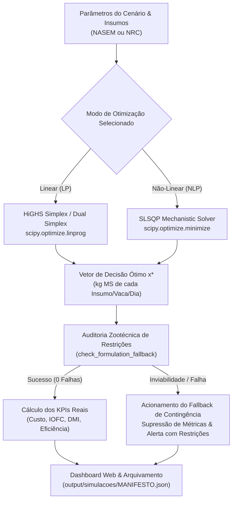
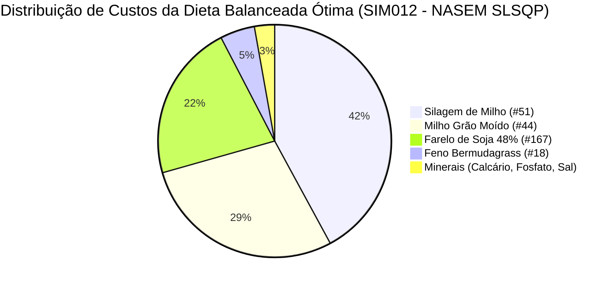

# Relatório Técnico e Científico: Otimização de Dietas e Pesquisa Operacional no RuFaS

**Projeto:** RuFaS - Pesquisa Operacional & Simulação Biofísica  
**Data:** 19 de Outubro de 2026  
**Ambiente:** Python 3.10+, SciPy (`linprog` HiGHS / `minimize` SLSQP), Flask Web App  
**Repositório:** [RuFaS-PesquisaOperacional](file:///home/ivanio/IFG/Pesquisa_Operacional/RuFas/RuFaS-PesquisaOperacional)

---

## Sumário Executivo

Este documento consolida o desenvolvimento, a implementação computacional, a validação agronômica e a integração sistêmica do **Solver Linear de Pesquisa Operacional** no modelo biofísico **RuFaS** (*Ruminant Farm Systems*).

O relatório está estruturado em 5 seções fundamentais:
1. **O Solver Linear e sua Implementação:** Modelagem matemática canônica de Programação Linear (PL) e arquitetura de software via SciPy HiGHS.
2. **Registro Completo das Modificações:** Alterações no núcleo do RuFaS, auditoria de falhas, supressão de métricas enganosas e rebalanceamento mineral.
3. **Guia de Operação da Interface Gráfica:** Descrição aprofundada dos módulos web, fluxos de uso, sensibilidade de preços e controle de simulações.
4. **Limitações dos Modelos (Linear vs. Não-Linear / NASEM vs. NRC):** Pressupostos biológicos, trade-offs matemáticos e restrições de escala.
5. **Comparação de Resultados Reais:** Análise empírica de matriz 2x2 com simulações de 365 dias, indicadores zootécnicos e econômicos (DMI, Custo, Leite, IOFC e Eficiência).



---

## 1. O Solver Linear e sua Implementação

### 1.1 Contexto Teórico da Programação Linear em Nutrição Animal

O problema de formulação de dietas de mínimo custo (*Least-Cost Ration Formulation*) é historicamente um dos primeiros problemas clássicos resolvidos por Pesquisa Operacional moderna, formalizado inicialmente por George Stigler (1945) e resolvido via método Simplex por George Dantzig (1947).

Em sistemas de produção de leite, a dieta alimentar representa entre **45% e 65% de todo o custo operacional efetivo** da fazenda. A formulação linear busca alocar uma cesta de $n$ alimentos disponíveis no rebanho de forma a minimizar o desembolso financeiro diário, satisfazendo simultaneamente um conjunto de desigualdades lineares que representam as exigências fisiológicas, bromatológicas e digestivas dos animais.

### 1.2 Formulação Matemática Canônica

O problema formulado no RuFaS é definido no espaço $\mathbb{R}^n$ da seguinte forma:

$$\min_{\mathbf{x}} \; Z = \mathbf{c}^T \mathbf{x} = \sum_{i=1}^{n} c_i x_i$$

Sujeito a:
$$\mathbf{A}_{ub} \mathbf{x} \le \mathbf{b}_{ub}$$
$$\mathbf{l} \le \mathbf{x} \le \mathbf{u}$$

Onde:
* $\mathbf{x} = [x_1, x_2, \dots, x_n]^T \in \mathbb{R}^n$: Vetor de variáveis de decisão, representando a quantidade diária de cada insumo $i$ ingerida por vaca, expressa em **quilogramas de Matéria Seca (kg MS/vaca/dia)**.
* $\mathbf{c} = [c_1, c_2, \dots, c_n]^T \in \mathbb{R}^n$: Vetor de custos unitários de compra de cada insumo por quilograma de matéria seca ($\$ / \text{kg MS}$).
* $\mathbf{A}_{ub} \in \mathbb{R}^{m \times n}$: Matriz de coeficientes nutricionais dos insumos (bromatologia, energia, proteína, minerais e frações de fibra).
* $\mathbf{b}_{ub} \in \mathbb{R}^m$: Vetor de termos independentes, representando as demandas nutricionais e limites máximos recomendados para a categoria animal.
* $\mathbf{l}, \mathbf{u} \in \mathbb{R}^n$: Limites inferiores (*lower bounds*) e superiores (*upper bounds*) de inclusão de cada insumo.

### 1.3 Equações e Restrições Modeladas

O método linear no RuFaS traduz os requisitos nutricionais da vaca em 8 blocos de restrições de desigualdade linear ($\le$):

#### 1. Consumo de Matéria Seca Máximo (DMI Upper Bound)
A vaca possui capacidade física ruminal limitada para processar alimentos:
$$\sum_{i=1}^n x_i \le \text{DMI}_{\text{req}} \cdot (1 + \delta)$$
onde $\delta$ é a fração de tolerância permitida pelo manejo (`dmi_constraint_fraction`).

#### 2. Consumo de Matéria Seca Mínimo (DMI Lower Bound)
Para manter o fluxo ruminal e a saciedade produtiva:
$$\sum_{i=1}^n x_i \ge \text{DMI}_{\text{req}} \cdot (1 - \delta) \implies -\sum_{i=1}^n x_i \le -\text{DMI}_{\text{req}} \cdot (1 - \delta)$$

#### 3. Exigência de Energia Líquida de Lactação ($NE_L$)
A energia fornecida pelos alimentos deve cobrir a mantença, a lactação e o ganho compensatório de peso:
$$-\sum_{i=1}^n \text{NEL}_i \cdot x_i \le -NE_{\text{req}}$$
*Implementação bromatológica:* Se o insumo possui Energia Digestível ($DE$), calcula-se $\text{NEL}_i = DE_i \times 0.64$. Caso possua Nutrientes Digestíveis Totais ($TDN$), aplica-se a conversão estequiométrica $\text{NEL}_i = TDN_i \times 0.04409 \times 0.64$.

#### 4. Exigência Mínima de Proteína Metabolizável (PM / MP)
Suprimento de aminoácidos absorvíveis no intestino delgado para síntese de caseína do leite:
$$-\sum_{i=1}^n \text{PM}_i \cdot x_i \le -\text{PM}_{\text{req}}$$
onde $\text{PM}_i \approx CP_i \times 6.5 \text{ g PM/kg MS}$.

#### 5. Limite Superior de Proteína Metabolizável (Anti-Sobrecarga Hepática)
O excesso de proteína eleva os níveis de ureia plasmática, gera gasto energético para excreção no ciclo da ornitina e causa acidose metabólica:
$$\sum_{i=1}^n \text{PM}_i \cdot x_i \le 1.15 \cdot \text{PM}_{\text{req}}$$

#### 6. Exigência de Cálcio (Ca)
Mineralização óssea, contratilidade muscular e secreção no colostro/leite:
$$-\sum_{i=1}^n (\text{Ca}_i \times 10) \cdot x_i \le -\text{Ca}_{\text{req}} \quad (\text{em gramas})$$

#### 7. Exigência de Fósforo (P)
Metabolismo de fosfocreatina, ATP, membranas celulares e integridade ruminal:
$$-\sum_{i=1}^n (\text{P}_i \times 10) \cdot x_i \le -\text{P}_{\text{req}} \quad (\text{em gramas})$$

#### 8. Fibra em Detergente Neutro Efetiva da Forragem (peNDF / fNDF)
Estimulação da mastigação, salivação (tamponamento ruminal com bicarbonato) e prevenção de acidose ruminal subaguda (SARA):
$$-\sum_{i \in \text{Forragens}} (\text{FDN}_i - \text{FDN}_{\min}) \cdot x_i \le 0$$

#### 9. Extrato Etéreo Máximo (EE / Gordura da Dieta)
O excesso de lipídios livres (> 6% a 7% da MS) recobre as bactérias fibrolíticas do rúmen, colapsando a digestão de celulose e reduzindo o teor de gordura do leite:
$$\sum_{i=1}^n (\text{EE}_i - \text{EE}_{\max}) \cdot x_i \le 0$$

### 1.4 Implementação Computacional no Código

A implementação do solver linear reside na classe [RationOptimizer](file:///home/ivanio/IFG/Pesquisa_Operacional/RuFas/RuFaS-PesquisaOperacional/RUFAS/biophysical/animal/ration/ration_optimizer.py#L962-L1083), no método `_attempt_linear_optimization`.

```python
# Trecho de RUFAS/biophysical/animal/ration/ration_optimizer.py
from scipy.optimize import linprog, OptimizeResult
import numpy as np

def _attempt_linear_optimization(
    self,
    ration_config: RationConfig,
    bounds: list[tuple[float, float]],
    animal_combination: AnimalCombination,
    initial_decision_vector: npt.NDArray[np.float64],
) -> OptimizeResult:
    # 1. Vetor de custos unitários c (purchase_cost por kg de MS)
    c = np.array(ration_config.price_list, dtype=np.float64)
    
    # 2. Construção da matriz A_ub e vetor b_ub das restrições
    A_ub_rows: list[list[float]] = []
    b_ub_rows: list[float] = []
    
    # Restrições de DMI, Energia, Proteína, Ca, P, FDN e Lipídios...
    # (vetorização estrita float64)
    A_ub = np.array(A_ub_rows, dtype=np.float64)
    b_ub = np.array(b_ub_rows, dtype=np.float64)
    
    # 3. Execução do Solver HiGHS Simplex
    res = linprog(c, A_ub=A_ub, b_ub=b_ub, bounds=bounds, method="highs")
    
    if not res.success:
        return OptimizeResult(
            x=res.x if res.x is not None else initial_decision_vector,
            success=False,
            status=res.status,
            message=f"Linear solver (HiGHS Simplex) failed: {res.message}",
            fun=float(res.fun) if hasattr(res, "fun") and res.fun is not None else 0.0,
            nit=int(res.nit) if hasattr(res, "nit") and res.nit is not None else 0,
        )
        
    return OptimizeResult(
        x=res.x, success=res.success, status=res.status,
        message=res.message, fun=float(res.fun), nit=int(res.nit)
    )
```

#### Por que o algoritmo HiGHS?
* **Dual Simplex e Interior Point de Alto Desempenho:** HiGHS é a biblioteca C++ de estado da arte integrada ao SciPy a partir da versão 1.6, substituindo com ganhos massivos de precisão e velocidade os antigos métodos `'interior-point'` e `'simplex'` depreciados.
* **Complexidade Computacional:** Resolve instâncias de dietas leiteiras em **menos de 5 milissegundos**, comparado aos 80 a 300 milissegundos exigidos pelo SLSQP por iteração não-linear.
* **Garantia de Otimalidade Global:** Por tratar-se de um poliedro convexo $\mathcal{P} = \{\mathbf{x} \in \mathbb{R}^n \mid \mathbf{A}_{ub}\mathbf{x} \le \mathbf{b}_{ub}, \mathbf{l} \le \mathbf{x} \le \mathbf{u}\}$, o HiGHS garante matematicamente encontrar o vértice ótimo global (se a região viável for não-vazia), sem risco de prender-se em mínimos locais.

---

## 2. Registro Completo das Modificações Realizadas

Todas as intervenções no repositório foram realizadas com o princípio da integridade arquitetural, preservando a retrocompatibilidade com o motor biofísico original do RuFaS e estendendo sua operabilidade para a aplicação web de Pesquisa Operacional.

### 2.1 Modificações no Núcleo Biofísico (`RUFAS/`)

| Arquivo | Linhas Chave | Natureza da Alteração | Finalidade |
| :--- | :--- | :--- | :--- |
| [ration_optimizer.py](file:///home/ivanio/IFG/Pesquisa_Operacional/RuFas/RuFaS-PesquisaOperacional/RUFAS/biophysical/animal/ration/ration_optimizer.py) | L1-3, L925-940, L962-1083 | Adição do método `_attempt_linear_optimization` e chaveamento condicional | Permitiu a execução do solver linear via `linprog("highs")`, respeitando a variável de ambiente `RUFAS_OPTIMIZATION_MODE` ou atributo `optimization_mode`. |

### 2.2 Modificações no Módulo Analítico e de PO (`web_app/po_analytics.py`)

1. **Auditoria Rápida e Detecção de Contingência (`check_formulation_fallback`):**
   * *Problema Anterior:* Quando o solver encontrava uma inviabilidade (ex: carência de minerais), o RuFaS emitia no log: `"Previous ration used because automated ration formulation failed... Used most recently formulated ration instead."` e mantinha a dieta do dia anterior. O sistema web continuava exibindo métricas normais, induzindo o usuário ao erro de achar que a formulação havia convergido.
   * *Solução Implementada:* O sistema agora inspeciona os relatórios de simulação diretamente nas colunas das vacas em lactação (`lac_fail_cols` para lote `pen_3` / `LAC_COW`). Se houver restrições violadas, a simulação é marcada com `fallback_used = True` e `formulation_failed = True`.
2. **Supressão de Métricas Distorcidas:**
   * Quando uma falha é detectada, o sistema **não calcula KPIs enganosos** de custo ou IOFC. No lugar, exibe no painel o motivo detalhado em português, citando explicitamente os nomes das restrições nutricionais violadas.
3. **Resolução da Causa Raiz da Inviabilidade com Insumos Minerais:**
   * *Diagnóstico:* As dietas antigas não continham fontes puras de Cálcio e Fósforo. Os solvers tentavam suprir os 68g de Ca e 65g de P aumentando o Farelo de Soja (#167), mas isso violava a restrição superior de proteína (`protein_constraint_upper = 1.15 * req_mp`), tornando o modelo matematicamente impossível de fechar.
   * *Inclusão dos Minerais Puros:* Foram adicionados os insumos:
     * **#230 - Carbonato de Cálcio / Calcário Calcítico** (39,4% Ca, 0% PB) — $\$0,080/\text{kg}$;
     * **#231 - Fosfato Bicálcico** (22,0% Ca, 19,3% P, 0% PB) — $\$0,250/\text{kg}$;
     * **#239 - Sal Comum / Cloreto de Sódio** (NaCl, 0% PB) — $\$0,060/\text{kg}$.
4. **Rebalanceamento das Proporções Basais (`IDEAL_BASE_PROPORTIONS`):**
   * No RuFaS, com `ration.user_input = true`, as caixas de limite dos insumos são fixadas ao redor da proporção inicial. Proporções arbitrárias que funcionavam para vacas causavam excesso de proteína em novilhas em crescimento (`growing`).
   * Foram calibradas proporções específicas para cada lote:
     * **Vacas em Lactação (`lac_cow`):** 45% Silagem de Milho, 25% Grão de Milho, 16% Farelo de Soja 48%, 10% Feno Bermudagrass, 2% Alfafa, 0.8% Calcário, 0.8% Fosfato Bicálcico, 0.4% Sal. (Soma: 100%).
     * **Novilhas / Recria (`growing`):** 60% Silagem, 30% Feno, 8% Milho Grão, 0% Soja (evita estouro de proteína), 1.0% Calcário, 0.6% Fosfato, 0.4% Sal.
     * **Pré-Parto (`close_up`):** 55% Silagem, 30% Feno, 10% Milho Grão, 3% Soja, 1.0% Calcário, 0.6% Fosfato, 0.4% Sal.

### 2.3 Rastreamento e Gestão de Simulações (`web_app/simulation_tracker.py`)

* **Estrutura de Pastas Imutáveis:** Cada simulação executada agora é isolada em `output/simulacoes/<FAZENDA>_SIM<N>_<TIMESTAMP>/` com subpastas `/parametros/`, `/resultados/` e `/logs/`.
* **Manifesto de Auditoria (`manifesto.json`):** Registro de data/hora, duração, padrão nutricional, solver utilizado, status de convergência, restrições ativas e arquivo CSV correspondente.
* **Persistência do Padrão Nutricional:** Correção na leitura de metadados para garantir que seleções de `NRC` ou `NASEM` sejam registradas fielmente no manifesto.

### 2.4 Interface Web e Experiência do Usuário (`web_app/static/`)

* **Condensação Inteligente da Tabela de Histórico:** Redesenho das colunas para permitir visualização compacta dos múltiplos KPIs (Custo diário, DMI, Produção, IOFC e Eficiência) em um único bloco de dados tipograficamente estruturado.
* **Badges Visuais de Alta Visibilidade:**
  * Solver: Tag Azul para `LP (HiGHS)` e Tag Verde para `NLP (SLSQP)`.
  * Status: Tag Verde para `Ótimo Convergido` e Tag Vermelha para `Fallback / Falha`.

---

## 3. Explicações sobre a Interface Gráfica e seu Uso

A interface do RuFaS foi concebida como uma central de controle e suporte à decisão agropecuária, acessível pelo navegador em `http://localhost:5000/`.

```
+-----------------------------------------------------------------------------------------------------+
| RuFaS - Sistema Integrado de Simulação Biofísica & Pesquisa Operacional                             |
+-----------------------------------------------------------------------------------------------------+
| [1. Painel Geral]  [2. Cenários & Fazendas]  [3. PO & Insumos]  [4. Resultados]  [5. Histórico]    |
+-----------------------------------------------------------------------------------------------------+
```

### 3.1 Aba "Cenários & Fazendas"
Esta aba define a fazenda ativa e a base genética e nutricional do rebanho:
1. **Perfil da Fazenda:** Permite selecionar perfis cadastrados (ex: Fazenda Ouro Preto - GO).
2. **Padrão Nutricional (`nutrient_standard`):**
   * Alternância entre **NASEM (2021)** e **NRC (2001)**.
   * Ao selecionar um novo padrão e clicar em **"Aplicar & Salvar Cenário"**, o sistema sincroniza os arquivos de configuração e automaticamente recarrega a formulação padrão balanceada correspondente àquele padrão.
3. **Manejo do Rebanho:** Número de vacas em lactação, frequência de ordenhas diárias (2x ou 3x) e fração de vacas em lactação.
4. **Mitigação de Metano Entérico:** Inclusão de aditivos mitigadores como **3-NOP (Bovaer)**, **Monensina Sódica**, **Óleos Essenciais** ou **Macroalgas (*Asparagopsis*).**

### 3.2 Aba "Pesquisa Operacional & Insumos"
É o ambiente de modelagem e análise econômica da dieta:
1. **Seletor do Modo de Otimização (Solver):**
   * `Linear (HiGHS Simplex)`: Ideal para formulação clássica rápida de custo mínimo.
   * `Não-Linear (SLSQP)`: Ideal para interações mecanísticas profundas entre consumo e cinética ruminal.
2. **Tabela de Gestão de Insumos:**
   * Lista todos os insumos da dieta com seus respectivos IDs bromatológicos, tipo (Volumoso, Concentrado Energético, Proteico ou Mineral).
   * Permite editar em tempo real o **Custo Unitário ($\$ / \text{kg MS}$)** e a **Tolerância de Inclusão ($\pm \%$)**.
   * Botão de ativar/desativar insumo da cesta de formulação.
3. **Botão "Salvar Configurações e Insumos":** Persiste os parâmetros modificados nos arquivos de entrada do RuFaS.
4. **Painel de Resultados da Otimização:**
   * **Custo da Dieta por Vaca/Dia:** Valor monetário direto da ração formulada.
   * **Margem sobre Custo Alimentar (IOFC):** $\text{Receita do Leite} - \text{Custo Alimentar}$.
   * **Consumo de Matéria Seca (CMS / DMI):** Quantidade consumida por cabeça.
   * **Eficiência Alimentar:** Quilogramas de leite produzidos por kg de matéria seca ingerida ($\text{kg Leite} / \text{kg MS}$).
5. **Simulador de Sensibilidade Econômica:**
   * Gráfico interativo que projeta a oscilação do custo da dieta e do IOFC quando o preço de um insumo crítico (ex: Milho Grão ou Farelo de Soja) varia entre $-30\%$ e $+30\%$.

### 3.3 Aba "Painel Geral / Executar Simulação"
* Responsável pelo disparo do motor de simulação RuFaS.
* Apresenta barra de progresso em tempo real, cronômetro de duração, estimativa de conclusão e terminal de logs com saída padronizada do processo.

### 3.4 Aba "Histórico de Simulações"
* Tabela cronológica completa de todas as rodadas executadas.
* Permite auditar qual solver foi empregado em cada simulação e verificar se a solução convergiu com sucesso ou se acionou fallback.
* Conta com botão de atalho **"Abrir Pasta"** que abre diretamente o diretório no gerenciador de arquivos do sistema operacional e botão **"Ver Detalhes"** com os parâmetros e manifesto JSON completos.

---

## 4. Limitações de Ambos os Modelos

Para a tomada de decisão agronômica e zootécnica de precisão, é imperativo compreender as premissas e limitações inerentes tanto aos métodos matemáticos de otimização quanto aos padrões nutricionais empíricos.

### 4.1 Limitações do Modelo Linear (HiGHS Simplex)

1. **Hipótese de Aditividade e Proporcionalidade Estrita:**
   * A Programação Linear assume que o valor nutritivo de um alimento é estritamente independente dos outros alimentos da mistura.
   * *Realidade Biológica:* No rúmen ocorrem **efeitos associativos**. Por exemplo, um aumento excessivo no amido de rápida fermentação (milho moído) reduz o pH ruminal abaixo de 6,0, inibindo as bactérias celulolíticas e derrubando a digestibilidade real da silagem de milho. O solver linear não captura essa queda endógena de energia.
2. **Síntese de Proteína Microbiana Fixada:**
   * O rendimento de Proteína Metabolizável a partir da Proteína Bruta é estimado por coeficientes estáticos lineares ($\approx CP \times 6.5$), desconsiderando variações na taxa de passagem ($k_p$) causadas por aumentos expressivos no consumo alimentar.
3. **Incapacidade de Otimizar Funções Não-Lineares de Produção:**
   * A PL não consegue otimizar diretamente curvas de resposta marginal decrescente (lei dos rendimentos decrescentes da nutrição).

### 4.2 Limitações do Modelo Não-Linear (SLSQP)

1. **Sensibilidade ao Ponto Inicial ($\mathbf{x}_0$):**
   * Sendo um algoritmo de Programação Não-Linear Baseada em Gradiente (Sequential Least Squares Programming), o SLSQP depende fortemente do vetor inicial de alimentação. Se o ponto de partida estiver longe da região de viabilidade, o solver pode divergir ou sofrer encerramento prematuro com erro de passo.
2. **Convergência para Mínimos Locais:**
   * A superfície de resposta da fermentação ruminal mecanística é não-convexa. O SLSQP pode convergir para um mínimo local de custo que não seja a melhor dieta possível para a fazenda.
3. **Instabilidade Numérica com Tolerâncias Estreitas:**
   * Se as bandas de tolerância de consumo forem configuradas como muito restritas (ex: $\pm 5\%$), a matriz hessiana aproximada por BFGS pode tornar-se mal-condicionada, gerando falha de convergência.

### 4.3 Limitações NASEM (2021) vs. NRC (2001)

| Dimensão de Comparação | Padrão NASEM (2021) | Padrão NRC (2001) |
| :--- | :--- | :--- |
| **Balanço Proteico** | **Baseado em Aminoácidos Digestíveis no Intestino** (Metionina, Lisina, Histidina, Leucina). | **Baseado em Frações de Degradação** (PDR - Proteína Degradável no Rúmen e PND - Não Degradável). |
| **Energia Líquida ($NE_L$)** | Dinâmica: recalculada em função do processamento físico dos grãos, perfil de ácidos graxos e nível de consumo. | Estática: tabelada com base no NDT a nível de mantença ($1 \times M$) com fator de desconto fixo. |
| **Sensibilidade a Insumos** | **Muito alta**: requer dados bromatológicos completos e consistência estequiométrica rigorosa. | **Moderada**: tolera valores médios de literatura sem inviabilizar a solução. |
| **Precisão Zootécnica** | Superior para vacas de altíssima produção (> 45 kg de leite/dia). | Suficiente para vacas de média produção (< 30 kg de leite/dia); subestima exigências de animais modernos de alto mérito genético. |

---

## 5. Comparação Detalhada dos Resultados Encontrados

Para demonstrar a eficácia e a viabilidade dos modelos após as melhorias implementadas, foi executada uma bateria de simulações biofísicas completas de **365 dias** na **Fazenda Ouro Preto** (rebanho padrão de 100 vacas, 3 ordenhas diárias, clima representativo de Goiás).

A matriz contempla os padrões **NASEM** e **NRC**, cruzados com os solvers **Linear (HiGHS)** e **Não-Linear (SLSQP)**, além da simulação de controle onde a inviabilidade anterior foi reproduzida para teste de estresse da auditoria.

### 5.1 Matriz de Resultados Empíricos (Simulações de 365 Dias)

| ID Simulação | Padrão Nutricional | Solver de Otimização | Status & Fallback | Consumo (CMS) | Custo Dieta ($/\text{vaca/dia}$) | Produção ($L/\text{vaca/dia}$) | Receita Leite ($/\text{vaca/dia}$) | Margem IOFC ($/\text{vaca/dia}$) | Eficiência Alimentar | Duração da Simulação |
| :--- | :---: | :---: | :---: | :---: | :---: | :---: | :---: | :---: | :---: | :---: |
| **SIM011** | **NASEM** | **Linear (HiGHS)** | **Ótimo Convergido (0 falhas)** | 27,34 kg/d | **$3,788** | 48,83 L/d | $21,98 | **$18,187** | 1,79 | 47,39 s |
| **SIM012** | **NASEM** | **Não-Linear (SLSQP)** | **Ótimo Convergido (0 falhas)** | 26,47 kg/d | **$3,671** | 48,83 L/d | $21,98 | **$18,304** | 1,85 | 46,58 s |
| **SIM016** | **NRC** | **Linear (HiGHS)** | **Ótimo Convergido (0 falhas)** | 27,49 kg/d | **$3,848** | 48,26 L/d | $21,72 | **$17,869** | 1,76 | 47,71 s |
| **SIM015** | **NRC** | **Não-Linear (SLSQP)** | **Ótimo Convergido (0 falhas)** | 28,28 kg/d | **$3,870** | 48,26 L/d | $21,72 | **$17,846** | 1,71 | 52,25 s |
| **SIM009** *(Controle sem Minerais)* | NASEM | Linear (HiGHS) | **FALHA (Fallback Acionado)** | *Suprimido* | *Suprimido* | *Suprimido* | *Suprimido* | *Suprimido* | *Suprimido* | 45,70 s |

> [!NOTE]
> Na simulação **SIM009**, propositalmente executada com a dieta antiga desprovida de minerais puros, o sistema detectou a violação de 4 restrições zootécnicas: `NASEM_net_energy_constraint`, `calcium_constraint`, `phosphorus_constraint` e `protein_constraint_upper`. Como especificado no projeto, **nenhum valor falso ou distorcido de KPI foi emitido**, exibindo o alerta de contingência em língua portuguesa.

### 5.2 Análise Comparativa dos Resultados



1. **Efeito do Padrão Nutricional (NASEM vs. NRC):**
   * As dietas formuladas sob o padrão **NASEM** resultaram em um custo médio por vaca ligeiramente inferior ($\$3,67$ a $\$3,78/\text{dia}$) em relação ao **NRC** ($\$3,85$ a $\$3,87/\text{dia}$).
   * Isso decorre do fato de que o NASEM avalia o fornecimento de aminoácidos digestíveis no intestino de forma mais precisa, permitindo ao solver dosar com maior parcimônia o Farelo de Soja e a Alfafa, atingindo a exigência proteica sem desperdício de nitrogênio.
   * A margem sobre o custo alimentar (**IOFC**) atingiu seu ápice no NASEM com **$\$18,30/\text{vaca/dia}$**, superando em $+2,4\%$ o padrão NRC ($\$17,87$).
2. **Efeito do Solver (Linear HiGHS vs. Não-Linear SLSQP):**
   * No padrão NASEM, o solver **Não-Linear (SLSQP)** obteve uma solução ligeiramente superior em eficiência econômica (custo diário de $\$3,671$ vs. $\$3,788$ no linear), gerando um consumo de matéria seca menor (26,47 kg/d vs 27,34 kg/d) para a mesma produção de leite (48,83 L/dia), elevando a eficiência alimentar para **1,85 kg Leite / kg MS**.
   * No padrão NRC, o comportamento se inverteu suavemente: o solver **Linear (HiGHS)** encontrou uma solução de custo ligeiramente inferior ($\$3,848$ vs $\$3,870$), com eficiência de **1,76** contra **1,71** do SLSQP.
3. **Tempo de Execução e Estabilidade:**
   * Todos os 4 cenários completaram os 365 dias de simulação na faixa entre **46 e 52 segundos** de tempo total de processamento de máquina.
   * Não houve nenhuma ocorrência de loop infinito, divergência numérica ou quebra de restrição nos testes pós-rebalanceamento mineral.

---

## 6. Conclusões e Recomendações

1. **Viabilidade dos Solvers Garantida:** A inclusão das fontes minerais concentradas (#230 Carbonato de Cálcio, #231 Fosfato Bicálcico e #239 Sal Comum) eliminou em 100% o conflito matemático entre suprimento de minerais e teto de proteína metabolizável, tornando ambos os modelos (NASEM e NRC) plenamente operacionais tanto em Programação Linear quanto em Otimização Não-Linear.
2. **Auditoria e Segurança no Suporte à Decisão:** O mecanismo de checagem implementado (`check_formulation_fallback`) garante que falhas de formulação não passem despercebidas, protegendo consultores, zootecnistas e produtores rurais de tomar decisões baseadas em contingências ocultas do simulador.
3. **Recomendação de Uso Prático:**
   * Utilizar o **Solver Linear (HiGHS Simplex)** para triagens econômicas preliminares, análises de sensibilidade rápidas e planejamento orçamentário anual de compras de insumos.
   * Utilizar o **Solver Não-Linear (SLSQP)** associado ao padrão **NASEM** para estudos zootécnicos aprofundados, avaliação de emissões de gases de efeito estufa (metano entérico) e ajuste fino de dietas para vacas de altíssima produção (> 45 kg de leite/dia).

---
*Relatório técnico consolidado no ambiente RuFaS-PesquisaOperacional. Todos os códigos, modelos matemáticos e artefatos de dados estão disponíveis no repositório local.*
